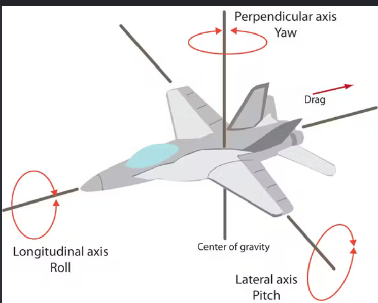

# 1. 認識 IMU

IMU 是量「自己怎麼動」的感測器。不需要 GPS,室內也能用。

## 三個角度

| 角度 | 自走車上的意思 |
|---|---|
| roll | 車身左右傾斜 |
| pitch | 車頭抬起或下壓(上下坡) |
| **yaw** | **車頭左轉、右轉** |

平地上的車子,roll、pitch 幾乎不變,重點是 yaw。

## 裡面有四種感測器

| 感測器 | 量什麼 | 弱點 |
|---|---|---|
| 加速度計 | 重力方向 → 知道有多斜 | 量不到 yaw |
| 陀螺儀 | 轉多快 | 累加成角度後會慢慢飄 |
| 磁力計 | 磁北方向 → 知道 yaw | 怕鐵、怕馬達 |
| 氣壓計 | 高度變化 | 受天氣影響 |

四種互補:陀螺儀反應快但會飄。roll、pitch 由加速度計拉回來;yaw 只有九軸模式才由磁力計拉回來。
這件事由模組裡的晶片自動完成(廠商稱為卡爾曼濾波),不用自己處理。

## 6 軸、9 軸、10 軸

| 配置 | 有什麼 | 差別 |
|---|---|---|
| 6 軸 | 加速度計 + 陀螺儀 | yaw 會飄 |
| 9 軸 | 6 軸 + 磁力計 | yaw 不飄,但怕磁干擾 |
| 10 軸 | 9 軸 + 氣壓計 | 多了高度 |

### yaw 的誤差會不會越積越多

| yaw 怎麼來 | 會越積越多嗎 | 原因 |
|---|---|---|
| 只靠陀螺儀累加(6 軸) | 會 | 每一次的小誤差都留在累加結果裡,沒有東西把它拉回來 |
| 加上磁力計(9 軸) | 不會 | 磁北是固定的參考,誤差會被拉回來 |

9 軸被磁場干擾時,yaw 會偏幾度。車子移動時離鐵件的距離在變,偏差也跟著變,但不會越積越多。

### 本教材用 6 軸

室內到處是樓板鋼筋、鐵櫃、馬達,磁力計一直被干擾。所以室內自走車用 6 軸:
yaw 只靠陀螺儀,慢慢漂掉的部分交給 LiDAR 對地圖修正。什麼時候才需要磁力計,見第 7 頁。

## 這顆 CMP10A

- 10 軸
- USB 連接,預設每秒送 10 筆資料
- 校正結果存在模組裡,換電腦也在
- 可以在 6 軸、9 軸之間切換(第 4 頁選項 `10`)