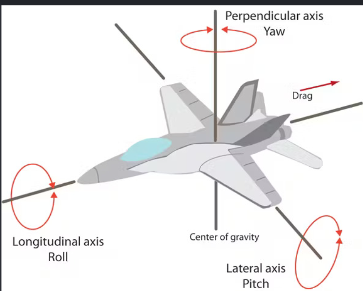

# 單元 1:IMU 是什麼

## 概觀

手機平放在桌上時,能持續且穩定地判斷自己是水平的;拿起來繞鉛直軸轉 90° 後,
它對「轉了多少」的估計只在短時間內可靠,之後逐漸偏離。
前者有重力作為絕對參考,後者只能靠角速度積分。本單元說明這個差異的來源,以及各種感測器如何互補。

## 定義

慣性量測單元 (Inertial Measurement Unit, IMU) 是把數個慣性感測器裝在同一塊板子上的模組,
量測載體本身的**運動狀態**:加速度與角速度。
它不依賴外部訊號(不像 GPS 需要衛星),因此在室內、隧道、水下都能用;代價是誤差會隨時間累積。

## roll、pitch、yaw

IMU 以三個角度描述載體的姿態,分別是繞三個互相垂直的軸旋轉的量。下圖以飛機為例:

| 名稱 | 旋轉軸 | 圖中的軸 | 飛機的動作 | 自走車的動作 |
|---|---|---|---|---|
| roll(翻滾) | 前後方向的軸(X) | Longitudinal axis | 左右機翼一高一低 | 車身向左或向右側傾 |
| pitch(俯仰) | 左右方向的軸(Y) | Lateral axis | 機頭抬起或下壓 | 上坡、下坡時車頭抬起或下壓 |
| yaw(偏航) | 上下方向的軸(Z) | Perpendicular axis | 機頭向左或向右轉 | 車子在地面上左轉、右轉 |

三個軸交於同一點,圖中標為重心 (center of gravity)。

對平地上行駛的自走車而言,roll 與 pitch 幾乎不變,**yaw 是最主要的量**:車子轉彎就是 yaw 在改變。
三個角度分別由哪些感測器決定、各自的可靠程度,在後面「感測器融合」一節說明。

圖中的箭頭表示各軸的旋轉方式,不代表角度的正負方向。本課角度的正負依右手定則與 ROS 的座標慣例決定,見後面「座標系與右手定則」一節。

## 四種感測器各自量到什麼

### 加速度計 (accelerometer)

量的是**比力 (specific force)**,而不是「運動加速度」。
靜止放在桌上時,加速度計讀到的不是 0,而是大小約 9.8 m/s²、方向朝上的值,
因為桌面正在以 1 g 的力托住它。自由落體時讀數才會是 0。

加速度計隨時量得到重力,因此能判斷模組是否水平:
重力分配到三個軸上的比例,直接對應 roll 與 pitch。

限制:

- 載體一加速(例如車子起步),運動加速度和重力混在一起,傾角估計就會出錯
- 繞重力方向旋轉(yaw)時,重力在三軸的投影完全不變,所以**加速度計對 yaw 一無所知**

MEMS 加速度計原理:一個微小的質量塊懸在彈簧上,受力時位移,位移改變電容,電容轉成電壓。
參考:[Accelerometer - Wikipedia](https://en.wikipedia.org/wiki/Accelerometer)

### 陀螺儀 (gyroscope)

量的是**角速度 (angular velocity)**,單位 °/s 或 rad/s。
要得到角度,必須把角速度隨時間累加(積分)。

累加有兩個問題:

1. 需要起始角度,陀螺儀自己給不出來
2. 量測值帶有固定偏移 (bias) 時,偏移也一起被累加,角度誤差**隨時間持續增長**,這就是漂移 (drift)

以數值為例:bias 為 0.1 °/s 時,一分鐘後角度誤差 6°,十分鐘 60°。
消費級 MEMS 陀螺儀的 bias 通常在 0.1–1 °/s 這個量級,而且隨溫度變。

MEMS 陀螺儀原理:振動中的質量塊在旋轉座標系中受科里奧利力 (Coriolis force),力的大小正比於角速度。
參考:[Vibrating structure gyroscope - Wikipedia](https://en.wikipedia.org/wiki/Vibrating_structure_gyroscope)

### 磁力計 (magnetometer)

量的是**磁場向量**,正常使用下主要是地磁場。地磁場方向在一個房間內可視為固定,
所以它提供一個「絕對」的水平參考,用來決定 yaw(航向角),補加速度計的不足。

台灣的地磁場總強度約 45 μT,磁傾角約 35°,亦即地磁向量並非水平,而是斜向下指。
這表示 IMU 傾斜時,必須先用 roll/pitch 把磁場向量「扶正」到水平面,再算 yaw,
這叫傾斜補償 (tilt compensation)。

限制:任何鐵磁性物體、馬達、大電流導線都會扭曲局部磁場。
地磁場只有 45 μT,一顆小喇叭的磁鐵在 5 cm 處就能輕易蓋過它。這是單元 3 的主題。

參考:[Earth's magnetic field - Wikipedia](https://en.wikipedia.org/wiki/Earth%27s_magnetic_field)、
[NCEI Magnetic Field Calculators](https://www.ngdc.noaa.gov/geomag/calculators/magcalc.shtml)(查任一地點的地磁參數)

### 氣壓計 (barometer)

量的是**大氣壓力**,由氣壓隨高度遞減的關係換算成高度。
地表附近每上升 8 m 約降 100 Pa;好的 MEMS 氣壓計解析度到 1 Pa 左右,理論上能分辨 10 cm。

限制:天氣變化一小時可改變數百 Pa,相當於數十公尺;室內開冷氣、關門都會有擾動。
所以氣壓高度只適合用於**相對**高度(起飛點歸零後),且短時間內有效。

## 6 軸、9 軸、10 軸的配置

上一節的四種感測器,依不同的組合構成 6 軸、9 軸、10 軸的 IMU。
「幾軸」是模組內各感測器量測軸數的加總,商品上也寫成 6DOF、9DOF、10DOF。
剛體在空間中只有 6 個自由度 (degrees of freedom),此處的 DOF 是商業用語,指的是量測軸數,不是自由度。
軸數多代表量到的物理量多,不代表精度高。

| 配置 | 感測器組成 | 可得到的量 | 得不到或受限的量 |
|---|---|---|---|
| 6 軸 | 三軸加速度計 + 三軸陀螺儀 | roll、pitch(以重力為絕對參考);角速度;比力 | yaw 只有相對值,由陀螺儀積分而來,隨時間漂移 |
| 9 軸 | 6 軸 + 三軸磁力計 | 上列各項,加上以地磁為參考的絕對 yaw | yaw 受周圍鐵磁性物體與電流干擾 |
| 10 軸 | 9 軸 + 氣壓計(1 軸) | 上列各項,加上相對高度 | 高度受天氣與氣流影響,只適合短時間的相對量測 |

### 6 軸

加速度計提供重力方向,陀螺儀提供角速度,兩者融合後 roll 與 pitch 長期穩定。
繞重力方向的旋轉(yaw)在加速度計上沒有任何訊號,只能由陀螺儀積分,因此 6 軸模組的 yaw 一定會漂移,
開機時的 yaw 也沒有絕對意義,通常直接定為 0。

- 代表晶片:InvenSense MPU-6050、ICM-42688-P,Bosch BMI270,ST LSM6DS3
- 典型用途:平衡車、相機雲台、手機螢幕旋轉、多旋翼的姿態內迴路
- 適用條件:不需要絕對航向,或航向由其他來源修正(輪式里程計、LiDAR、GPS、視覺)

室內移動機器人常採用 6 軸:馬達與鋼構使磁力計不可靠,yaw 改由 SLAM 或里程計修正。

### 9 軸

加入三軸磁力計後,地磁場提供水平面上的絕對參考,yaw 不再漂移。
這種配置又稱 MARG (Magnetic, Angular Rate, Gravity);搭配融合演算法、直接輸出姿態的模組稱為
AHRS (Attitude and Heading Reference System)。

- 代表晶片:InvenSense ICM-20948(MPU-9250 的後繼),Bosch BNO055(晶片內建融合),ST LSM9DS1
- 典型用途:需要絕對航向的載具、頭戴裝置、電子羅盤
- 代價:磁力計必須校正,且安裝位置受限(單元 3)

市面上另有「6 軸電子羅盤」(加速度計 + 磁力計,例如 ST LSM303),沒有陀螺儀,
靜止時可得姿態與航向,動態響應差。選購時應確認 6 軸指的是哪一種組合。

### 10 軸

再加入氣壓計,由氣壓換算高度。氣壓計只有一個量測量,所以是 9 + 1。
模組通常以 9 軸晶片搭配獨立的氣壓計晶片(Bosch BMP280、BMP388,TE MS5611)組成。

- 典型用途:多旋翼定高、樓層判斷、登山錶
- 限制:只能作相對高度,使用前需在參考高度歸零

本課使用的 CMP10A 屬於 10 軸,並內建融合用的 MCU,因此也是一顆 AHRS。

### 選用原則

| 需求 | 建議配置 |
|---|---|
| 只需要 roll、pitch(平衡、水平偵測) | 6 軸 |
| 需要絕對航向,且安裝處可遠離鐵件與馬達 | 9 軸 |
| 需要航向,但環境磁干擾嚴重 | 6 軸,yaw 由外部感測器修正 |
| 需要高度變化(飛行器、樓層) | 10 軸 |

10 軸模組可以只取用其中 6 軸的資料。配置的選擇決定的是可用的資訊上限,實際使用多少由應用決定。

## 把四種感測器合起來:感測器融合

上面四種感測器的優缺點恰好互補:

| 想知道的量 | 短期準、長期漂 | 長期穩、短期吵 |
|---|---|---|
| roll / pitch | 陀螺儀積分 | 加速度計(重力方向) |
| yaw | 陀螺儀積分 | 磁力計(地磁方向) |
| 高度 | 加速度計二次積分(幾乎不能用) | 氣壓計 |

感測器融合 (sensor fusion) 就是把「短期準」與「長期穩」的來源以適當權重合併:
平常以陀螺儀的結果為主,再持續用加速度計與磁力計把累積的誤差拉回來。

卡爾曼濾波器 (Kalman filter) 是最常用的融合方法。它依據各感測器的可信程度自動分配權重:
雜訊大的來源權重低,雜訊小的權重高。使用時不需要推導它的數學,只需要知道兩件事:

- CMP10A 板上的 MCU 已經做了融合,輸出的 roll/pitch/yaw 是融合後的結果(廠商稱為卡爾曼濾波,演算法未公開)
- 自走車上還會再做一次融合:ROS 2 的 `robot_localization` 套件以擴展卡爾曼濾波器 (EKF) 合併 IMU 與輪速。
  EKF 是演算法,`robot_localization` 是實作它的套件,
  設定方式見 [08-ros2-integration.md](08-ros2-integration.md)

磁力計只參與 yaw 的修正。磁力計受干擾時,融合結果中出錯的是 yaw,roll 與 pitch 不受影響(單元 3 以實驗驗證)。

## 描述姿態:Euler 角與四元數

姿態 (orientation) 就是「IMU 的座標系相對於世界座標系轉了多少」。常見兩種表示:

- **Euler 角**:roll(繞 X)、pitch(繞 Y)、yaw(繞 Z)三個角度,直觀,但有萬向鎖 (gimbal lock):
  pitch = ±90° 時 roll 與 yaw 無法區分。而且旋轉順序不同結果不同,本模組用 Z-Y-X 順序。
- **四元數 (quaternion)**:以四個數 (x, y, z, w) 表示一個旋轉。沒有萬向鎖,適合運算,但不直觀。
  ROS 的 `sensor_msgs/Imu` 與 TF 都用四元數。

實務上:人看數字用 Euler 角,ROS 訊息用四元數,轉換由 driver 完成,不需要手算。

參考:[Euler angles - Wikipedia](https://en.wikipedia.org/wiki/Euler_angles)、
[Quaternions and spatial rotation - Wikipedia](https://en.wikipedia.org/wiki/Quaternions_and_spatial_rotation)

## 座標系與右手定則

IMU 的三個軸構成右手座標系:右手食指指 X、中指指 Y,拇指就是 Z。
旋轉的正方向也用右手定則:拇指指向軸的正向,四指彎曲的方向就是正旋轉。

哪個軸朝前、哪個朝上,各家慣例不同。ROS 的規範 [REP-103](https://www.ros.org/reps/rep-0103.html)
規定載體座標系 X 朝前、Y 朝左、Z 朝上;本 repo 的 driver 遵循此慣例。
CMP10A 板上印有箭頭標示 X、Y 方向,Z 垂直板面向上(元件面)。

## 實驗 1-1:手機就是 IMU
打開 phyphox,依序觀察三件事:

1. **加速度(含重力)**:手機平放桌上,三軸讀數中有一軸接近 9.8 m/s²。
   把手機立起來,9.8 m/s² 會移到另一軸。
2. **陀螺儀**:手機平放不動,觀察三軸讀數。數值放大後通常可見固定的小偏移,即 bias。
3. **磁力計**:手機平放不動,讀總強度 (magnitude);拿鑰匙或鐵製品靠近 3 cm,看總強度變多少。

三項觀察分別對應:加速度計量到重力、陀螺儀有 bias、磁力計受鐵磁性物體干擾。
後續單元在 CMP10A 上處理的即是這三件事。

## 本單元重點

- 加速度計量的是比力,靜止時讀到 1 g;能給 roll/pitch,不能給 yaw
- 陀螺儀量角速度,積分得角度;bias 使角度誤差隨時間線性增長
- 磁力計提供 yaw 的絕對參考,但極易受鐵磁性物體干擾
- 氣壓計給相對高度,受天氣影響
- 感測器融合用互補的特性消除各自弱點;CMP10A 在晶片內完成

## 延伸閱讀

- Oliver J. Woodman, *An introduction to inertial navigation*, University of Cambridge Technical Report UCAM-CL-TR-696, 2007.
  三十多頁把 IMU 誤差模型講得非常清楚,強烈建議讀第 1–4 章。
- Sebastian O.H. Madgwick, *An efficient orientation filter for inertial and inertial/magnetic sensor arrays*, 2010.
  開放原始碼 AHRS 演算法的代表作,比卡爾曼濾波器容易看懂。
- [Inertial measurement unit - Wikipedia](https://en.wikipedia.org/wiki/Inertial_measurement_unit)
