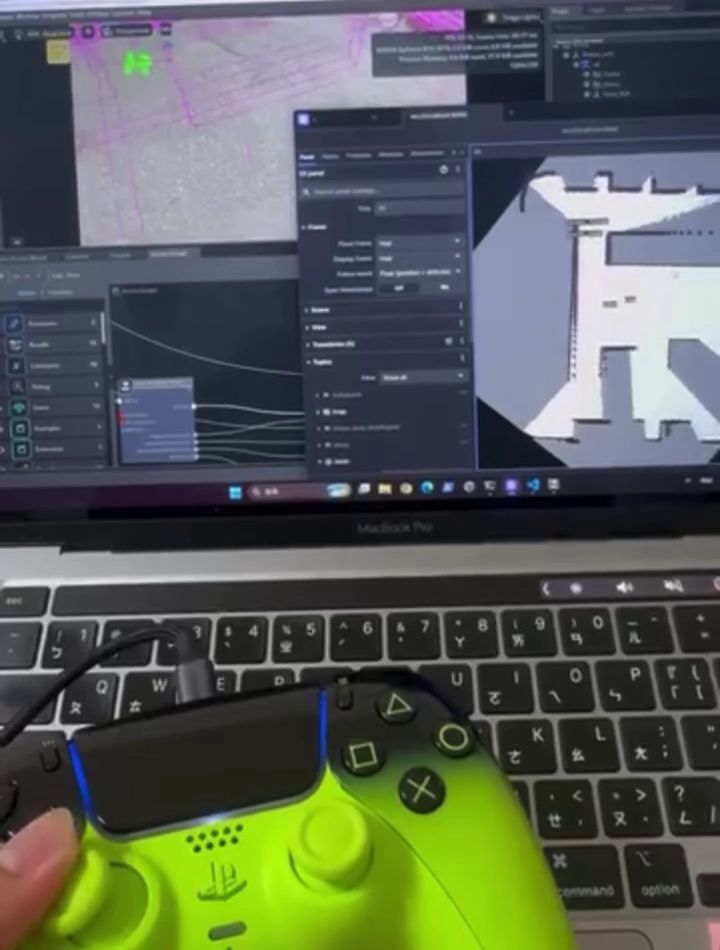

# 6. 接進 ROS 2

**目標:讓自走車用到 IMU。**

範例套件:[urdf_odom_pkg](https://github.com/alianlbj23/urdf_odom_pkg)。
以下內容尚未在實體車上驗證。

<a href="video/816247060.447867.mp4"></a>

用 urdf_odom_pkg 實際跑起來的畫面:用手把遙控車子,地圖一邊開一邊變大。點圖片看影片(29 秒)。

## 整體怎麼運作

```
輪子 ─┐
      ├─▶ EKF ─▶ odom(車子走了多遠、轉了多少)
IMU  ─┘
LiDAR ─▶ slam_toolbox ─▶ 地圖,並修正 odom 的誤差
```

- 輪子:給**前進速度**
- IMU:給**轉向速度**
- 兩者合起來就是 odom。它連續,但會慢慢歪掉
- LiDAR 比對環境,把歪掉的部分修回來

## 兩個名詞

| 名詞 | 是什麼 |
|---|---|
| EKF | 把多個感測器合併的方法(卡爾曼濾波的一種) |
| `robot_localization` | 已經寫好 EKF 的 ROS 2 套件,只要寫設定檔 |

## 座標系(TF)

```
map ─▶ odom ─▶ base_link ─▶ imu_link
                        └─▶ laser
```

| 名稱 | 意思 | 誰產生 |
|---|---|---|
| `map` | 地圖 | `slam_toolbox` |
| `odom` | 車子的起點 | EKF |
| `base_link` | 車體 | — |
| `imu_link`、`laser` | 感測器裝在車上的位置 | static transform 或 URDF |

**每一段只能有一個來源。** 重複了,車子在畫面上會亂跳。

## 啟動範例

```bash
# 建圖(輪子 + IMU + LiDAR)
ros2 launch urdf_odom_pkg cus_slam.launch.py use_sim_time:=false

# 只要 odom,不建圖
ros2 launch urdf_odom_pkg localization.launch.py use_sim_time:=false
```

## EKF 設定的重點

`config/ekf.yaml` 裡,每個感測器有 15 個 true / false,決定用它的哪些資料。

### 15 個狀態的意思

依序每 3 個一列:

| 列 | 狀態 | 意思 | 單位 |
|---|---|---|---|
| 1 | x, y, z | 位置:前後、左右、上下 | 公尺 |
| 2 | roll, pitch, yaw | 姿態角:繞 x、y、z 軸轉了多少 | 弧度 |
| 3 | vx, vy, vz | 線速度:位置每秒變多少 | m/s |
| 4 | vroll, vpitch, vyaw | 角速度:姿態角每秒變多少 | rad/s |
| 5 | ax, ay, az | 線性加速度:線速度每秒變多少 | m/s² |

### urdf_odom_pkg 的設定

```yaml
twist0: /wheel_twist        # 輪子:只用前進速度
twist0_config: [false, false, false,
                false, false, false,
                true,  false, false,
                false, false, false,
                false, false, false]

imu0: /imu                  # IMU:只用轉向速度
imu0_config: [false, false, false,
              false, false, false,
              false, false, false,
              false, false, true,
              false, false, false]
```

這份設定的意思:**前進只信輪子,轉向只信 IMU。**
IMU 的 yaw 沒有用到,所以磁干擾不影響這份設定。這就是本教材的做法:IMU 用六軸,只開 vyaw。

### IMU 能給 EKF 什麼

`robot_localization` 最常用 IMU 的 yaw 角速度,其次是姿態角,線性加速度通常不開。

IMU 的資料格式(`sensor_msgs/Imu`)有三組,對應 `imu0_config` 的 15 個 true / false:

| 資料 | 對應狀態 | 平面輪型機器人常見用法 |
|---|---|---|
| 角速度 `angular_velocity` | vroll, vpitch, vyaw | 開 vyaw,這是最主要、最可靠的數值 |
| 姿態 `orientation` | roll, pitch, yaw | 有磁力計、或 IMU 內建融合時才開 yaw(例如 CMP10A 的 9 軸模式、BNO055) |
| 線性加速度 `linear_acceleration` | ax, ay, az | 通常不開:雜訊大,累加後容易漂移 |

### 九軸時才用 IMU 的 yaw

本教材用六軸,不開 yaw。改用九軸、而且下面三項都確認過,才考慮也開 yaw:

```yaml
imu0_config: [false, false, false,   # x, y, z
              false, false, true,    # roll, pitch, yaw
              false, false, false,   # vx, vy, vz
              false, false, true,    # vroll, vpitch, vyaw
              false, false, false]   # ax, ay, az
```

開 yaw 之前先確認:

- IMU 是 9 軸模式(第 4 頁選項 `10`)
- 磁力計已在車上校正過(第 4 頁 `3` 或 `4`),車子周圍磁干擾小(第 3 頁)
- 座標方向符合 ROS 的規定(REP-103)。`urdf_odom_pkg` 的 `ekf.yaml` 註解也寫明,確認之前只用角速度

### 什麼時候需要磁力計

室內自走車不在這張表裡,所以用六軸。

| 情況 | 為什麼需要 |
|---|---|
| 無人機 | 在空中沒有牆面可以對地圖,懸停時 GPS 也給不出方向 |
| 戶外機器人剛開機、還沒移動 | GPS 只給位置;要動起來才能從軌跡推算方向,靜止時只能靠磁力計 |
| 開闊場地(農田、操場、水面) | 四周沒有特徵,LiDAR 和相機都對不到東西 |
| 水下載具 | 沒有 GPS,視野也差 |
| 手機、穿戴裝置 | 沒有輪子和 LiDAR,只剩磁力計能給方向 |
| 要對應真實地理方向的任務 | 例如「往北走 50 公尺」、天線或太陽能板對向 |

### 為什麼線性加速度通常不開

在室內輪型機器人上,加速度能提供的資訊,輪子已經有更準的版本;而加速度本身的誤差又跟訊號差不多大,加進去弊大於利。

**1. 速度已經有更好的來源**

加速度的用途是推算速度。但輪子的編碼器(量輪子轉了多少的感測器)直接量出速度,不用累加、不會漂。有了它,加速度就是多餘的。

**2. 訊號和誤差一樣大**

室內車加減速通常只有 0.3–0.5 m/s²,而且只出現在起步和煞車的瞬間,等速時是 0。
消費級加速度計的偏移約幾十 mg(1 mg 是千分之一個重力),20 mg 就是約 0.2 m/s²。

誤差跟要量的東西同一個量級,濾波器很難分辨哪個是真的。

**3. 重力會混進來**

重力是 9.8 m/s²,比車子的加速度大二、三十倍。車身只要傾斜 1°(過門檻、地板不平、加速時車頭抬起),就有約 0.17 m/s² 的重力被誤認成水平加速度。

**4. 震動雜訊**

馬達和輪子滾動的震動會直接出現在加速度讀數上,幅度常常比車子真正的加速度還大。

**為什麼角速度就可以用**

| | 角速度(陀螺儀) | 線性加速度 |
|---|---|---|
| 要累加幾次才得到結果 | 1 次(變成角度) | 2 次(變成位置) |
| 誤差怎麼長 | 時間加倍,誤差加倍 | 時間加倍,誤差變 4 倍 |
| 受重力影響 | 不受 | 受 |
| 有沒有更好的替代來源 | 沒有,輪子轉彎會打滑 | 有,編碼器 |

所以不是加速度計沒用:它在 IMU 內部還是負責靠重力算 roll 和 pitch。
只是「拿它的水平加速度來幫忙定位」這件事,在有輪式里程計(用輪子算出的移動距離)的室內車上不划算。

## 這個 repo 只負責打開 IMU

`python3 imu.py` 啟動後,只會送出 IMU 的資料,不會多出別的座標系:

| 送出的東西 | 預設 |
|---|---|
| IMU 資料的 topic | `/imu/data` |
| 資料上標的 frame 名稱 | `imu_link` |
| `world → imu_link` 的 TF | **不發佈** |

`imu_link` 要接到車子的哪裡(`base_link → imu_link`),由車子那邊決定,不在這裡設定。

## 用選單改設定

```bash
python3 imu.py
```

選 `8 設定`:

| 項目 | 預設 | 什麼時候改 |
|---|---|---|
| IMU topic 名稱 | `/imu/data` | 別的套件要的名字不同。例如 `urdf_odom_pkg` 要 `/imu` |
| frame 名稱 | `imu_link` | 車子的設定用了別的名字 |
| 發佈 `world → frame` 的 TF | 否 | 只想在桌上用 Foxglove 3D 看模組轉動時才開。**上車要關** |
| 網路 | `bridge` | 要讓其他容器收到 IMU 資料時,填 `host`,或直接**輸入自訂的 Docker 網路名稱** |
| ROS_DOMAIN_ID | `0` | 同一個網路有多台車時,每台用不同數字(0–232) |

設定存在 `config/launcher.json`,下次啟動生效。

網路填的是**名稱**,可以填三種:

| 填什麼 | 是什麼 | 誰看得到 IMU 的 topic |
|---|---|---|
| `bridge` | Docker 預設網路 | 只有 Foxglove(透過 8765 / 9090 埠) |
| `host` | 主機網路 | 同一台電腦上所有 ROS 2 程式與 host 容器,以及同網段的電腦 |
| 其他名稱,例如 `compose_my_bridge_network` | 自訂的 Docker 網路 | 接在同一個網路上的容器 |

注意:compose 檔裡的 `driver: bridge` 是網路的**類型**,不是名稱。
自己建的網路類型也是 bridge,但它和 Docker 預設那個名叫 `bridge` 的網路是不同的網路,兩邊不互通。
要和 compose 裡的容器互通,填的是那個網路的名稱,不是 `bridge`。

不管哪一種,**兩邊的 ROS_DOMAIN_ID 要一樣**才看得到彼此。

車子的程式用 docker compose 啟動時,通常已經有自己的網路。把 IMU 接上去的步驟:

1. 先啟動車子的 compose(網路是它建立的)
2. `docker network ls` 找出網路名稱。compose 建立的名稱通常是「資料夾名稱_網路名稱」(資料夾名稱會轉成小寫),
   例如 compose 檔在 `compose/` 資料夾、網路叫 `my_bridge_network`,實際名稱就是 `compose_my_bridge_network`。以 `docker network ls` 列出的為準
3. `imu.py` 選 `8` → `4`,輸入這個名稱(選單會列出電腦上現有的網路供參考)
4. ROS_DOMAIN_ID 設成和車子一樣

網路不存在時,`imu.py` 會直接說明原因並停下來,不會自動建立。

## 接上 urdf_odom_pkg

| 做什麼 | 怎麼做 |
|---|---|
| topic 對上 | `imu.py` 選 `8`,把 IMU topic 改成 `/imu` |
| 網路互通 | `imu.py` 選 `8`,網路填 `host` 或車子所在的 Docker 網路名稱 |
| 座標名稱對上 | `cus_slam.launch.py` 裡的 `sim_imu` 改成 `imu_link` |
| 關掉模擬時間 | 啟動時加 `use_sim_time:=false` |

## 檢查

```bash
ros2 topic hz /imu/data              # 有資料,約 10 Hz(topic 改過名字就用新名字)
ros2 topic hz /odometry/filtered     # EKF 有輸出
ros2 run tf2_tools view_frames       # TF 是一條完整的鏈
```

## 出問題時

| 現象 | 原因 |
|---|---|
| 車子在畫面上亂跳 | 同一段 TF 有兩個來源 |
| 多出一個 `world` | `imu.py` 選 `8`,把「發佈 world → frame 的 TF」關掉 |
| EKF 說找不到 `imu_link` | 座標名稱沒改,或沒有設定 IMU 的安裝位置 |
| 車子右轉,畫面左轉 | IMU 裝的方向和設定不符 |
| 靜止時朝向慢慢轉 | 陀螺儀偏移:開機後靜置約 5 秒再開車(第 4 頁選項 `9`) |
